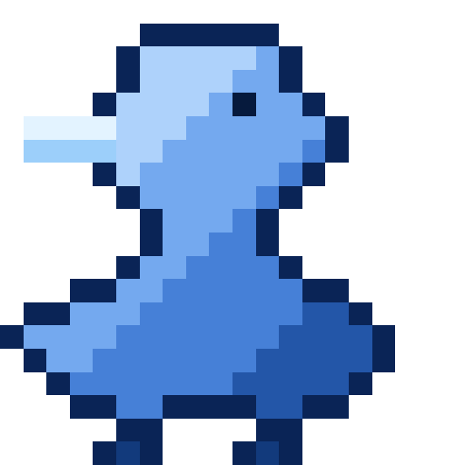

# Hi, I'm Louis, aka Parityyy

I'm studying cybersecurity at HEIG-VD and doing a PiBS internship at CHUV. I like taking software that has aged or been put together quickly and making it clearer, safer and easier to maintain.

- PiBS internship at CHUV
- BSc in cybersecurity at HEIG-VD, finishing in 2028
- Interested in infrastructure, OSINT and connected devices (IoT)
- CTF challenges when I have some spare time, mostly OSINT

## Tools

I'm open to opportunities and side projects. The easiest way to reach me is on [LinkedIn](https://www.linkedin.com/in/louis-bindschedler-4b7b54378).
